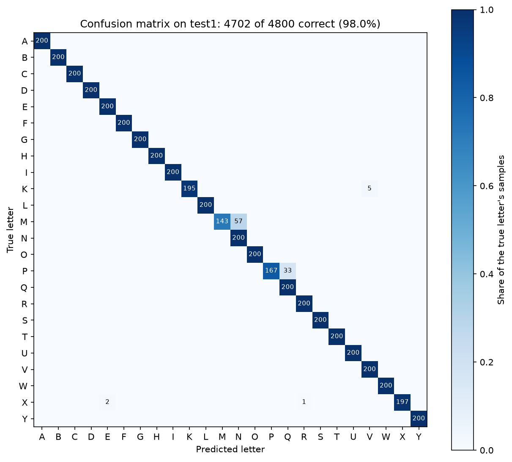

# ASL Alphabet Recognizer

Real-time ASL alphabet recognition from a webcam, using MediaPipe hand landmarks and a small PyTorch classifier.

**98.0% accuracy** on a held-out test session recorded on a different day, under lighting and a background the model never saw.

## Results

| Session | Accuracy | Role |
|---|---|---|
| Validation (`val1`) | 98.5% | Used for early stopping and every design comparison |
| Test (`test1`) | **98.0%** (4,702 of 4,800) | Evaluated once, after every decision was final |

The model recognizes the 24 static letters of the ASL fingerspelling alphabet. J and Z involve motion, so they're out of scope for this version.

**Known limitations:** 90 of the 98 test mistakes fall in two letter pairs. At certain hand angles, M is read as N (71.5% accuracy on M) and P as Q (83.5% on P). I traced both to one-sided coverage in my second training session: it added these letters at new angles without enough of their neighboring letters at the same angles. The natural next step is a training session that covers both sides of each boundary.



## How it works

```
Webcam frame
  → MediaPipe HandLandmarker: 21 hand landmarks (x, y, z)
  → normalization: wrist as the origin, scaled by palm length, left hands mirrored
  → 63-number feature vector
  → classifier: 63 → 128 → 64 → 24, with ReLU and 20% dropout
  → softmax, averaged over the last 10 frames
  → the letter is shown if its averaged confidence is at least 0.7
```

The classifier only ever sees hand geometry, never pixels, so background and lighting barely affect it. That was the main weakness of v1, which I built in summer 2025 with OpenCV and TensorFlow. It reached about 90% accuracy, but only under clean lighting against a controlled background.

Every design decision, with the options considered and the reasoning behind each choice, is recorded in [architecture.md](architecture.md).

## Data

- **The Kaggle ASL Alphabet dataset:** 55,368 photos in which MediaPipe found a hand, used for training only
- **My own webcam recordings:** two training sessions, one validation session, and one test session, each with 4,800 samples (24 letters × 2 bursts × 100 frames), recorded on different days under different lighting and backgrounds

Data is split by session, not by random frames. Frames within a recording burst are nearly identical, so a random split would leak near-duplicates between training and evaluation and inflate the scores.

Recordings store only hand landmark coordinates, never images.

## What I learned along the way

- **Data quality beat every model change.** My first validation score was 85.2%. I then realized I'd signed some letters incorrectly while recording. After re-recording, validation rose to 99.0% with no change to the model or training.
- **Testing a hypothesis against a baseline.** I expected class-balanced sampling to help, so I kept the unweighted mix as a switchable baseline. The baseline won (98.5% vs. 97.0%). Balanced batches repeated my small, highly correlated recording sessions several times per epoch, and the model appears to have overfit to them.
- **Error analysis down to individual frames.** Validation errors weren't random. They came in contiguous runs at specific hand angles. When adding a second training session introduced new errors, I audited it with a model that had never seen it, which traced the new errors to specific samples in that session.
- **Measuring whether a noisy feature earns its place.** Depth (z) is MediaPipe's noisiest output. Shuffling it across validation samples dropped accuracy from 98.5% to 88.2%, with the losses concentrated in letters that differ mainly by depth (M fell from 93.5% to 42.5%), so z stayed.
- **Choosing the demo's confidence threshold from evidence.** At 0.7, the threshold kept 96.5% of correct per-frame predictions on validation while hiding 69.9% of wrong ones.

## Project structure

```
asl-alphabet-recognizer/
├── asl/                    # building blocks, one module per pipeline stage
│   ├── labels.py           # the 24 letter labels
│   ├── landmarks.py        # MediaPipe hand landmark extraction
│   ├── features.py         # normalization → 63-number feature vector
│   ├── data.py             # saved .npz files → features and labels
│   └── model.py            # the classifier, plus saving, loading, and running it
├── prepare_kaggle_data.py  # Kaggle photos → landmark data
├── collect_data.py         # record labeled landmark samples from the webcam
├── train.py                # training with early stopping
├── evaluate.py             # per-letter accuracy and the most common confusions
├── run_demo.py             # live webcam recognition
├── data/recordings/        # my recording sessions (landmarks only)
└── architecture.md         # the full decision log
```

## Running it

Developed on Windows with Python 3.13.

**1. Set up the environment:**

```powershell
python -m venv .venv
.venv\Scripts\Activate.ps1
pip install -r requirements.txt
```

**2. Download MediaPipe's hand landmark model** into `models/`:

```powershell
New-Item -ItemType Directory -Force models
Invoke-WebRequest -Uri https://storage.googleapis.com/mediapipe-models/hand_landmarker/hand_landmarker/float16/latest/hand_landmarker.task -OutFile models/hand_landmarker.task
```

**3. Download the [Kaggle ASL Alphabet dataset](https://www.kaggle.com/datasets/grassknoted/asl-alphabet)** and unzip it into `data/raw/kaggle_asl_alphabet/`, so the letter folders end up at `data/raw/kaggle_asl_alphabet/asl_alphabet_train/asl_alphabet_train/A/` and so on. Then extract the landmarks:

```powershell
python prepare_kaggle_data.py
```

**4. Train, evaluate, and run the demo:**

```powershell
python train.py
python evaluate.py test1
python run_demo.py --hand right
```

Trained weights aren't included in the repository, but training is seeded, so rerunning `train.py` on the same setup rebuilds the same model. Use `--hand left` if you sign with your left hand. Left hands are mirrored to match the right-handed training data.

**To record your own sessions:**

```powershell
python collect_data.py my_session --hand right --samples 100
```

Press a letter key to record a burst of that letter, Backspace to undo the last burst, and Esc to save and quit.

## Acknowledgments and license

- The [ASL Alphabet dataset](https://www.kaggle.com/datasets/grassknoted/asl-alphabet) by Kaggle user grassknoted, licensed under GPL-2.0. The dataset isn't included in this repository.
- [MediaPipe](https://github.com/google-ai-edge/mediapipe) by Google, for hand landmark detection.

This repository's code and recordings are released under the MIT License. The Kaggle dataset keeps its own GPL-2.0 license.